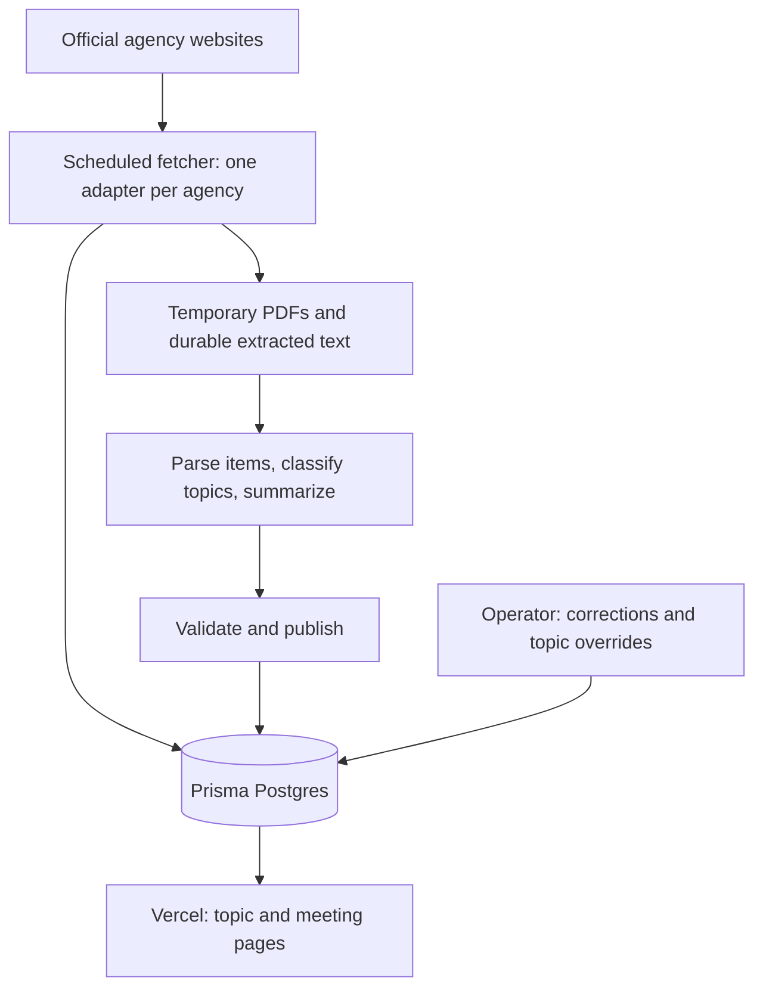

# Architecture overview

Status: selected service architecture; not implemented. See [decision 0005](../decisions/0005-selected-stack.md) and [implementation handoff](../planning/implementation-handoff.md). Code is tracked in local Git and is intended for eventual public open source. Frontend framework, AI model/provider, and license remain open.

## Shape of the system

Google Cloud Scheduler triggers a Python container on Cloud Run Jobs. The pipeline writes structured records to Prisma Postgres and publishes a read-only website to Vercel. Visitors read already-processed content; their page views do not trigger scraping or model calls. One codebase can contain the website, processing tools, and operator controls without deploying a separate service for each step.

## 1. Source adapters

Adapters for South Lake Tahoe, Truckee, and TTD discover meetings, logistics, agenda links, and document revisions. Each translates its agency's publishing conventions into the same internal format. Shared code handles fetch limits, retries, hashes, and job status. Start with the existing TTD Python code where suitable.

A changed document creates a new version. A missing page or failed request does not mean a meeting was canceled. Record cancellations only from source evidence. Fetch cadence remains a choice to validate against source behavior and freshness needs.

## 2. Durable records

Store structured entities in a relational database: agencies, meetings, agenda items, topic assignments, summaries, corrections, and processing runs. Preserve extracted page-separated text and source/version metadata in document storage, referenced from the database. Original PDFs are temporary processing inputs and are discarded after successful durable extraction/processing; see the accepted [document retention policy](document-retention.md). Public source links can remain on agency hosts under any policy.

Use local PostgreSQL for production-schema parity with Prisma Postgres. The existing TTD SQLite tooling may inform ingestion but is not the selected production database. Start with text storage in Postgres if comfortably within quotas; object storage for text/backups remains an implementation choice. Cloud Run scratch storage is temporary.

Original documents and extracted text are evidence. AI summaries are derived output that can be regenerated. Operator corrections and overrides are separate records and must survive reprocessing. A source revision flags affected corrections for possible staleness rather than silently rewriting them.

## 3. Processing and publication

Extract PDF text with page boundaries, split packets into agenda items, then classify items into the four initial topics and generate cited summaries. Use OCR when extraction requires it, subject to the processing budget. One item may match multiple topics.

Validate structured output and source/page references before publication. These checks catch malformed or unsupported references; they do not guarantee factual correctness. Factual summaries publish automatically, without a mandatory human review stage. There is one editorial voice and no attributed commentary ([decision 0010](../decisions/0010-single-editorial-voice.md)).

Cache work by source content and processing version. A retry should resume incomplete work rather than duplicate meetings or repeatedly bill for unchanged text. One scheduled process plus a job/status table is enough initially; an external queue is not required.

## 4. Website

The homepage and four topic pages prioritize upcoming items across agencies, then recent history. Meeting pages add full agenda context, logistics, participation instructions, and source links. Include visible update times, revisions, cancellations, and source freshness. Default ordering is chronological; optional editorial highlights should be labeled.

Pages can be generated at publication time or served from the database. Prefer prebuilt or cached public pages when deployment supports them, because the MVP has no resident accounts or personalized content. A dynamic public API is optional, not an MVP dependency.

## 5. Operator tools

Start with local commands or a local admin screen to inspect failures, rerun processing, correct metadata, and override topic tags. If administration becomes remotely accessible, require authentication and authorization. Do not expose the existing TTD local notes server directly as a production admin service.

Show last successful checks, failed jobs, model usage, and estimated spend. Keep backups of structured records and extracted text, without a permanent PDF archive; generated pages can be rebuilt. Failed updates preserve the last usable publication with an explicit stale/revision state. When AI work is paused, verified titles, logistics, and source links can still be published.

## Deployment and cost boundary

The website runs on Vercel; the Python worker runs as a Google Cloud Run Job, scheduled by Cloud Scheduler. Prisma Postgres stores structured records. Verify actual Vercel identity/scope before any project link or deployment. The Google project and Prisma workspace still need identification. The selected services plausibly fit the budget; actual usage remains to be measured.

Visitors do not incur model calls. Budget controls cap new AI/OCR work, cache unchanged documents, and bound retries. A scheduling host must be reliably available; local development does not imply production jobs depend on a personal computer.

## Public-source layout

- `apps/web/`: public pages and any later admin UI.
- `workers/ingestion/`: source adapters, extraction, enrichment, and publication jobs.
- `packages/domain/`: shared schemas and contracts; use language-neutral schemas if the web and worker use different languages.
- `config/`: public agency/topic configuration and example environment settings.
- `tests/fixtures/`: small redistributable or synthetic source examples.
- `docs/`: architecture, plan, decisions, ideas, and research.

Keep runtime PDFs, databases, logs, API keys, and private notes separate from distributable source. Provide setup instructions and example configuration so others can run their own instance. Select a license before public release; public visibility alone is not an open-source license. Review the original design's named outreach list before publishing. No Git initialization is needed now.

## Growth path

Add agencies through adapters and topics through configuration. Add alerts later by consuming published item revisions, leaving scraping and summaries unchanged. Search can index existing item text; a vector database is not required for the MVP. Accounts, public submissions, and live discussion are separate future capabilities with their own operating needs.
